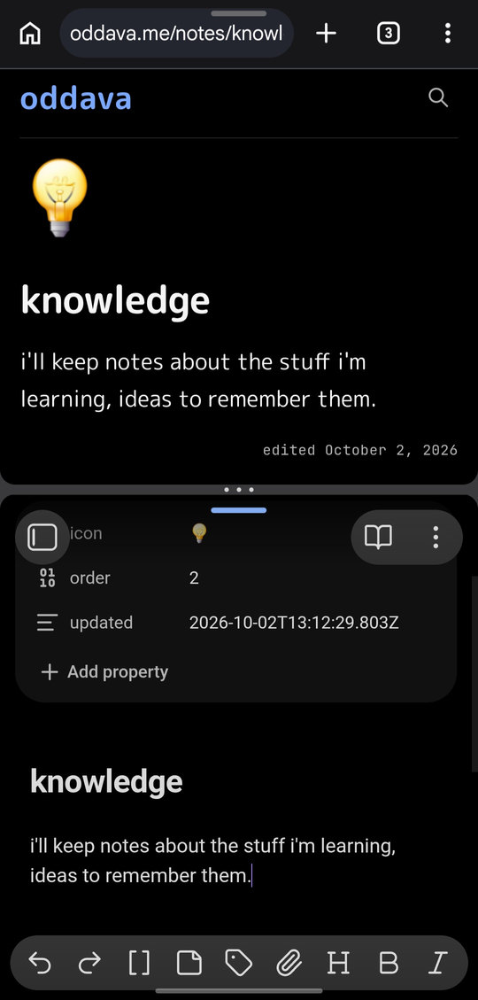
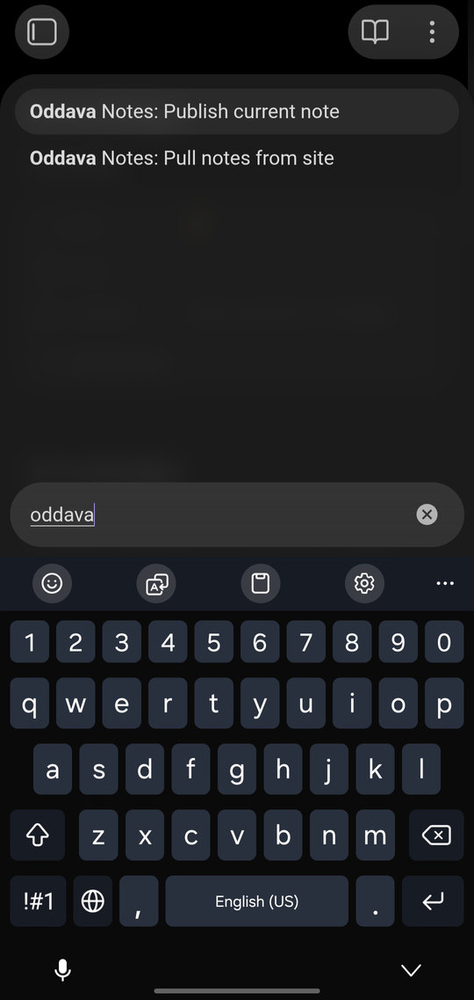
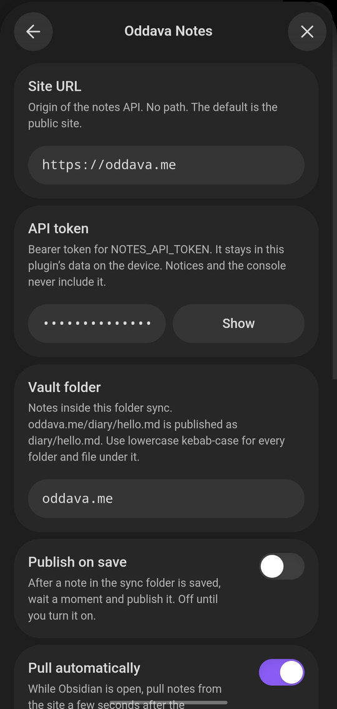

# Oddava Notes

An Obsidian plugin that publishes Markdown notes from a vault folder to [oddava.me](https://oddava.me) and pulls notes back down, including on a timer while Obsidian is open. It runs on desktop and on the Obsidian mobile apps.

The site already stores the garden. This plugin is a client for the notes API: a bearer token, a path, and a revision.

## Screenshots

Shot on Android. Oddava Notes works in Obsidian mobile.

<table>
  <tr>
    <td align="center">
      
      <br>
      The note on the site and in Obsidian
    </td>
    <td align="center">
      
      <br>
      Publish and pull
    </td>
    <td align="center">
      
      <br>
      Settings on the phone
    </td>
  </tr>
</table>

## Install in 1 minute

1. In Obsidian, install **BRAT** from Community plugins (Settings → Community plugins → Browse → BRAT). Enable it.
2. Open BRAT’s settings and choose **Add beta plugin**. Enter `oddava/obsidian-oddava-notes`.
3. Enable **Oddava Notes**.
4. On a device that already has the token, open Oddava Notes settings and click **Copy setup link for another device**. Open that link here. On a phone, send the link to yourself and tap it.

The link looks like `obsidian://oddava-notes-setup?token=...&url=...&folder=...`. Obsidian hands it to the plugin, which saves the site URL, token, and vault folder, runs **Test connection**, and shows the result. `url` and `folder` can be left off; the token cannot.

The link contains the API token. Send it only to yourself.

The first publish or pull creates the sync folder if it is not there yet (`oddava.me` by default). With a token saved, the automatic pull does that too. If the open note sits outside that folder, a notice offers to move it in and publish it.

### Manual install

The plugin id is `oddava-notes`. Copy these three files into `<vault>/.obsidian/plugins/oddava-notes/`:

- `main.js`
- `manifest.json`
- `styles.css`

Reload Obsidian, enable **Oddava Notes**, then open a setup link or paste the token in settings.

You can pin **Publish current note**, **Pull notes from site**, and **Post current note to Telegram** to the mobile toolbar from the command palette.

## What you can do

- **Publish current note.** The open note is created on the site, or updated if this device has published or pulled it before.
- **Pull notes from site.** Notes that are missing locally are downloaded. Notes the site has changed, and you have not, are updated. If both sides changed, neither side is overwritten.
- **Pull automatically.** On by default. A few seconds after the workspace is ready, then every 5 minutes, the plugin pulls while Obsidian is open. It uses the same rules as **Pull notes from site**, including conflict copies, so unpublished local edits are not overwritten. Nothing is announced when the vault is already current. A short notice appears when notes were downloaded or a conflict file was saved. If a pull fails (the phone is offline, for example), that error is shown once and then stays quiet until a later pull succeeds.
- **Publish on save.** Optional. Off until you turn it on. After Obsidian saves a note in the sync folder, the plugin waits 1.5 seconds and publishes it. It never posts to Telegram.
- **Post current note to Telegram.** Manual. Posts a note that is already on the site: bold title, a short excerpt, and the public link (`https://oddava.me/notes/diary/hello` for `diary/hello.md`). A confirmation shows the exact text. Cancel sends nothing.
- **Publish and post to Telegram.** Publishes the open note, then opens that same confirmation.
- **Test connection.** The settings tab lists how many notes the site currently has.

Removing a note in the vault does not delete it on the site until you say so. See [Renames and deletes](#renames-and-deletes). Studio can still remove a note on its own.

## Settings

| Setting | Default | What it does |
| --- | --- | --- |
| Site URL | `https://oddava.me` | Origin only. `http://127.0.0.1:8787` works for a local Worker. |
| API token | empty | The `NOTES_API_TOKEN` bearer token. The field is masked. |
| Vault folder | `oddava.me` | Only notes under this folder sync. |
| Publish on save | off | Debounced publish after a save. |
| Pull automatically | on | Repeating pull while Obsidian is open. |
| Auto-pull interval | 5 minutes | At least 1 minute between pulls. |
| Telegram bot token | empty | From @BotFather. Masked. The bot must be a channel admin. |
| Telegram channel | `@justoddava` | Where posts go. A `@channel` or a numeric id. |
| When a note is deleted | Ask | Delete on the site, keep it, or ask. Site deletes go to the trash. |

`oddava.me/diary/hello.md` in the vault is `diary/hello.md` on the site. Every folder and file name under the sync folder has to be lowercase kebab-case (`reading/atomic-habits.md`, `diary/06-10-2026.md`). Spaces, capitals, and underscores are rejected before a request is sent. That is the same rule the API uses.

The notes API token and the Telegram bot token are stored in the plugin’s `data.json` inside the vault (`.obsidian/plugins/oddava-notes/data.json`). Do not commit that file, and do not put either token in this repository. Notices never include them.

## Post to Telegram

Posting is manual. Publishing a blank page first, then filling it in, must not announce the blank page.

1. In Telegram, open **@BotFather** and send `/newbot`. Copy the token it gives you.
2. Add that bot as an admin of the channel (the default is `@justoddava`) and allow it to post messages.
3. Paste the token into **Telegram bot token**. Change **Telegram channel** only if you are not posting to `@justoddava`.
4. Publish the note, then run **Post current note to Telegram**. Or run **Publish and post to Telegram**, which publishes and then asks you to confirm the post.

The message is the title in bold, a short plain-text excerpt, and the public URL. `diary/hello.md` is `https://oddava.me/notes/diary/hello`, the same path the site uses. A note that is outside the sync folder, or not published yet, is refused. A nearly empty note warns you and waits for Cancel or Send.

The channel message id is stored in the note as `telegram_message_id`. The site drops that key (it only keeps title, icon, order, and updated), so a pull copies it back onto the site text. The note body is what revisions compare, so the id does not look like a different essay. Other devices that share the vault see the same id.

`telegram: true` in the frontmatter opts that note in. A manual **Publish current note** (the command or the ribbon) then posts it after a successful publish, if the note has at least 40 characters of text once frontmatter and Markdown are stripped, and no message id yet. That first post does not show the confirmation preview. Skipping the preview is on purpose: the flag plus the publish is the request, and the preview stays on **Post current note to Telegram** and **Publish and post to Telegram**. A shorter note is skipped with a short notice. **Publish on save** never posts and never edits the channel, because it runs while you are still typing.

Publishing a note that already has `telegram_message_id` updates that channel post when the text changed. If Telegram says the text is unchanged, that counts as success. If the channel post was deleted, the plugin tells you and leaves the id in place so you can send a new one on purpose. **Post current note to Telegram** on a note that was already posted offers **Update existing** and **Post new**.

## Create the token

The API answers `503` with `notes_api_disabled` until `NOTES_API_TOKEN` is set. A placeholder such as `your_notes_api_token` counts as unset.

Generate a value:

```bash
openssl rand -hex 32
```

Do not reuse `ADMIN_PANEL_TOKEN`. A leaked plugin token must not also open Studio.

Locally, put the value in the site’s `.env` as `NOTES_API_TOKEN`.

In production it is a Cloudflare secret. From the site repo, after `pnpm exec wrangler login`:

```bash
pnpm exec wrangler secret put NOTES_API_TOKEN
```

Wrangler prompts for the value so it does not land in shell history. Setting the secret redeploys the Worker.

The API also needs the note store (Redis) and `COMMUNITY_SIGNING_SECRET`. Rate limiting signs the client IP with that secret, so a missing signing secret fails requests with `503` even when the bearer token is right.

Paste the same value into the plugin settings. **Test connection** should report how many notes are on the site.

## Conflicts

The site keeps a revision on every note. It changes on every successful write. The plugin sends that revision on update.

If the site replies `409` with `revision_conflict`, your note stays as it is and the site copy stays as it is. The plugin downloads the site Markdown and saves it next to your note as `hello (site conflict).md`. The `409` body has the new revision but not the Markdown, so the plugin fetches the note before writing that file.

Merge the two files yourself, delete the conflict file, then publish again. The retry sends the revision from the conflict, so your merge replaces the site copy only if the site has not moved on again. If it has, you get a new conflict file.

Publishing does nothing while the conflict file is still there, so an autosave cannot overwrite the site in the background.

`POST` is used when this device has no revision yet. `409 path_exists` with the same writing just remembers the revision (the first request may have landed). Different writing becomes a conflict file, not a blind overwrite. `409 slug_exists` means that file name is already used in another folder. Names are unique across the whole garden. The plugin stops and tells you.

## Pull

Pull asks for the list, then fetches a note only when the list says it needs a closer look.

- Missing in the vault: download it.
- Same revision, and the vault text still matches the last sync: nothing to do.
- Same revision, but you edited the vault note: leave it. Those edits are unpublished.
- Site revision changed, vault text unchanged since the last sync: download the site copy.
- Both sides changed: conflict file. Neither side is overwritten.
- This device has never synced the file: a newer `updated` time on the site replaces the vault note. A newer `updated` time in the vault wins. If there is no way to tell, the plugin writes a conflict file instead of guessing.

`updated` lives in the note frontmatter. The server sets it on every save. The plugin does not invent one when you type.

Automatic pull runs that same pass. It starts a few seconds after the workspace layout is ready, then repeats on the interval in settings (5 minutes by default, and never less than 1). Turn it off with **Pull automatically**. **Pull notes from site** still works and still shows the full summary, including notes that were left unchanged.

An automatic pull does not start while another pull is already running. The next interval tries again. **Pull notes from site** waits for the one in progress to finish, then runs.

No notice when every note was already in sync, or when local edits were left unpublished. A short notice when at least one note was downloaded or a conflict file was written. The same failure is not announced again on later intervals. It is announced again after a pull succeeds, so a new outage is not silent forever. With no token, or no site URL, automatic pull does nothing and shows nothing.

A note that is in the site trash is not downloaded again. If you left it on the site, the next pull brings it back into the sync folder.

## Renames and deletes

Renaming a note inside the sync folder calls `POST /api/notes/move` with the revision this device remembers. The old public URL redirects to the new one. The vault file has already moved; the plugin tells the site to follow it.

Moving a note out of the sync folder is treated like a delete: the file stays where you put it, and the plugin asks what to do with the site copy. Moving a note into the sync folder is a new note. It is published only when **Publish on save** is on, the same as creating a file there.

Deleting a synced note in the vault does not delete it on the site by itself. **When a note is deleted** chooses:

- **Ask** (the default). A dialog offers **Delete on site too** and **Keep on site**.
- **Always delete on the site.** The site copy goes to the trash without a dialog.
- **Keep on the site.** The garden keeps the note. The next pull can download it again.

A site delete is soft. The note leaves the garden and stays in the trash, and it can be restored. The list endpoint returns those notes in `deleted`, separate from `notes`. Pull does not recreate a note that is in that trash. If you had it synced, the plugin stops tracking it and says it was left in the trash.

If the site renamed a note (Studio, or another device), pull follows `409 moved` and `location`: it renames the vault file when the destination is free and points the remembered revision at the new path. `410 gone` means the note is in the trash. The notice offers **Restore**, which calls `POST /api/notes/restore`. `409 deleted` means a trashed note still holds that path, so create and move will not overwrite it. Restore it, or pick another path. Those three are not reported as a bare HTTP status.

## Frontmatter

The site only keeps `title`, `icon`, `order`, and `updated`. Other keys (tags, aliases, a revision) are dropped on save. `icon` has to be one emoji or a path like `/images/notes/icon.png`. `order` has to be a whole number. Anything else comes back as `validation_failed`.

Because those extra keys do not survive a save, the plugin does not store the revision inside the note. It stores it in plugin data, next to a fingerprint of the text it last synced. The fingerprint is how pull tells your edits apart from the site’s. It is not a secret and it is not a security hash.

Publish sends the Markdown you wrote. It does not rewrite your vault file with the canonical copy the site stores (that copy gains `order` and `updated`). Pull does write the site’s Markdown when the site copy wins.

## Mobile

`isDesktopOnly` is `false`. HTTP goes through Obsidian’s `requestUrl`, which exists on iOS and Android. The plugin does not import Node, Electron, or `fetch`. There is no status-bar item, because that API is desktop-only.

The repeating pull uses `window.setInterval`, registered with Obsidian’s `registerInterval` so it is cleared when the plugin unloads. Changing **Pull automatically** or the interval clears the previous timer and starts a new one. A phone that is offline does not get a notice on every attempt.

Plugin data, including the token, lives on each device unless you sync `.obsidian`. A phone that has the plugin but no token can open a setup link instead of typing the token. The handler uses the same settings screen as the desktop app.

The site allows 120 requests a minute. A pull is one list plus one fetch per note that actually changed. The automatic interval is at least one minute so those pulls are not stacked in a tight loop. Over the limit, the plugin stops and shows `Retry-After` rather than looping. An automatic pull shows that error once, not on every later interval, until a pull succeeds.

## Develop

```bash
npm install
npm test
npm run build
```

`npm test` runs the path mapping, sync, auto-pull, and Telegram tests with a fake notes API, a fake clock, and a fake Bot API. `npm run build` typechecks, bundles `src/main.ts` to `main.js` with esbuild, and checks that the bundle does not call Node or `fetch`.

`npm run dev` watches and rebuilds while you work.

`npm version 1.0.3` runs `version-bump.mjs` (also `npm run version-bump`), which writes that version into `manifest.json` and `versions.json`. Push a tag with the same number and no `v` prefix (`1.0.3`, not `v1.0.3`). The release workflow checks the tag against the manifest, then publishes `main.js`, `manifest.json`, and `styles.css`.

The layout follows the official sample plugin: `src/main.ts`, `esbuild.config.mjs`, `manifest.json`, `versions.json`, `styles.css`, `version-bump.mjs`.

## Design

The notes API is already the front door. Studio keeps using its cookie. This plugin cannot hold that cookie, and a phone is not the site’s origin, so every call sends `Authorization: Bearer <token>`.

A note’s identity is its path inside the garden, not a number. The vault folder is only a local prefix. Stripping `oddava.me/` is the whole mapping. The plugin checks the kebab-case rule locally so a bad path fails with a notice instead of a `400`.

Updates are compare-and-set. The plugin remembers the last revision it saw. The next publish sends it. If someone saved in Studio in between, the site returns `409 revision_conflict` and writes nothing. The plugin then fetches the current note and parks it beside yours. It does not retry the same PUT. Retrying a stale revision in a loop would only keep failing, and omitting the revision would mean “overwrite whatever is there,” which is how a phone would erase a Studio edit it has not read.

The revision is not frontmatter. The schema strips unknown keys, and the server rewrites `updated` on every save. Putting `revision` in the file would vanish on the next publish, and it would also change the file on every success, which would trip publish-on-save again. Plugin data is the side table: path → revision + fingerprint of the vault text we last agreed on.

The fingerprint is the other half of pull. The list endpoint does not send the body, only `path`, `title`, `updated`, and `revision`. If the revision matches and the fingerprint matches, pull does not even download the note. If the revision changed and the fingerprint still matches, you did not edit, so the site copy is safe to download. If both changed, pull refuses to pick a winner.

Create is the path for “I have no revision.” A lost response can still have landed, so a second create returns `path_exists` plus the current summary (again, no body). The plugin fetches the note. Same writing: remember the revision. Different writing: conflict file. That is the same idea as the sync pass in the API docs, just scoped to one note for publish and to the whole list for pull.

Rate limiting and the disabled-API response are shown as notices, not thrown away. `content_busy` means the mutation lock is held; try again rather than stacking another write. The body cap is 1 MB, checked before the request so a huge note does not spend the token on a `413`.

A second device should not have to type the token. Obsidian can open `obsidian://oddava-notes-setup?...` and pass the query string to the plugin. The token is a query parameter because that is the channel a phone and a computer already share. The plugin writes it into plugin data and does not print it. The link is a secret, the same way `data.json` is a secret.

Automatic pull is the same function as **Pull notes from site**. The schedule is a short timeout after the layout is ready, plus an interval. Both are cancelled on unload and when the toggle or the interval changes. A pull in progress holds a lock. The interval does not start a second one; the command runs after the lock clears. Notices on the automatic path are filtered. No vault change and no new error means silence, so a phone in a pocket does not toast “already up to date” or the same offline error every five minutes. Conflict copies are unchanged: unpublished local edits stay in the note, and the site copy is written beside it.

Telegram is a separate manual step. The bot token stays in plugin data, like the notes API token. The message id stays in the note, because that file is what another device already syncs. Publish on save does not call `sendMessage` or `editMessageText`. A manual publish of a note with `telegram: true` may send the first post, and a later manual publish may edit it, and only when the rendered text changed. `message is not modified` is treated as success. HTTP still goes through `requestUrl`.
